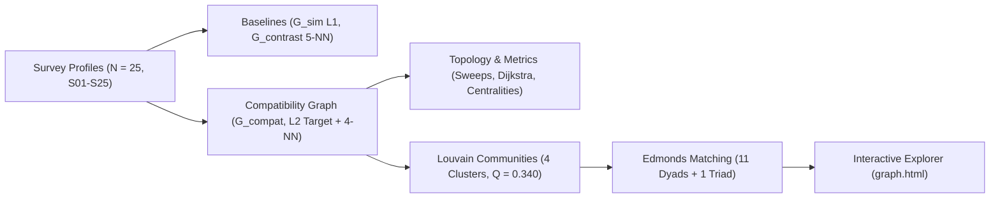

# MBTI Student Compatibility Network

This project models work-group compatibility among students as a weighted graph based on continuous 16Personalities scores (`Energy E`, `Mind N`, `Nature T`, `Tactics J`, `Identity A`). Starting from tabular survey responses ($N = 25$ completed profiles out of $33$ enrolled students, anonymized as `S01`–`S25`), we compare two simple baselines (trait similarity and trait contrast) against a 5D target-partner compatibility graph built with $k$-nearest neighbors ($k = 4$), analyze its structural properties (connectivity, shortest-path distances, centralities, and Louvain communities), and derive an optimal cohort team assignment via maximum-weight matching.



---

## Repository Structure

- `base_notebook.ipynb` — Main Jupyter notebook (data cleaning, graph construction, baseline comparisons, connectivity sweeps, distance and centrality plots, Louvain community detection, maximum-weight team assignment, and interactive Plotly visualizations on the anonymized cohort).
- `mbti_profiles_anon.csv` — Anonymized class survey dataset (`S01`–`S33`, randomly permuted to prevent roster re-identification) included for direct reproducibility.
- `graph.html` — Standalone interactive network explorer (PyVis / `vis-network`) with Louvain community filtering and optimal team highlighting.
- `pyproject.toml` & `uv.lock` — Reproducible `uv` project configuration (`mbti-graph-analytics`) and locked dependency graph.

---

## How to Run and Reproduce

1. **Clone the repository**
   ```bash
   git clone https://github.com/Waxguillermo/mbti-graph-analytics.git
   cd mbti-graph-analytics
   ```

2. **Set up the Python environment with [`uv`](https://docs.astral.sh/uv/)**
   ```bash
   uv venv --prompt mbti-graph-analytics
   uv sync
   source .venv/bin/activate
   ```

3. **Run the notebook**
   Open `base_notebook.ipynb` in Jupyter / VS Code (kernel `mbti-graph-analytics`) and run all cells from top to bottom. It loads `mbti_profiles_anon.csv` directly and regenerates `graph.html`, which can be opened in any web browser.

---

## Network Models Overview

All three models are represented as simple, undirected, weighted graphs over the $N = 25$ completed student profiles:

| Model | Construction Rule | Nodes | Edges | Density | Components | Louvain Modularity $Q$ |
| :--- | :--- | :---: | :---: | :---: | :---: | :---: |
| **Baseline 1 — Trait Similarity (`G_sim`)** | Pairwise similarity $\ge 80\%$ across 5 continuous traits | 25 | 174 | `0.580` | 1 | `0.126` |
| **Baseline 2 — Trait Contrast (`G_contrast`)** | Top-5 most opposing profiles per student (union) | 25 | 97 | `0.323` | 1 | `0.117` |
| **Final Model — Compatibility (`G_compat`)** | Symmetric 5D target-partner fit + $k$-NN ($k = 4$) | **25** | **73** | **`0.243`** | **1** | **`0.340`** |

---

## Analytical Pipeline

1. **Graph Modeling & Baselines** — Continuous 5D trait encoding (`Energy E`, `Mind N`, `Nature T`, `Tactics J`, `Identity A`) comparing $L_1$ homophily (`G_sim`) and polar contrast (`G_contrast`) against a normalized $L_2 / \sqrt{5}$ target-partner model (`G_compat`), verified invariant across anchor sweeps $\alpha \in [0.55, 0.75]$ ($12/12$ identical optimal matched pairs).
2. **Connectivity & Sensitivity Sweeps** — Component analysis across models and full parameter sweeps over similarity thresholds and neighbor counts $k$.
3. **Shortest-Path Distance Metrics** — Unweighted hop bounds, raw friction costs ($d = 1 - w$), and mean-normalized friction ($\tilde{d} = (1 - w) / \mu_{1-w}$) with explicit center/periphery identification on `G_compat` (diameter `4` hops / `0.619` raw / `4.37` mean-scaled; radius `2` hops / `0.312` raw / `2.21` mean-scaled; center `S15`, weighted periphery `S05, S10`).
4. **Centrality Profiles** — Multi-scale evaluation of degree, weighted strength, hop & weighted betweenness, hop & weighted closeness, and eigenvector centralities distinguishing core hubs (`S15`, `S01`, `S07`, `S22`) from friction-weighted connectors (`S19`, `S25`, `S14`).
5. **Community Detection** — Weighted Louvain optimization (`seed = 42`, $k = 4$ in `88/100` random seeds with modal `[9, 6, 6, 4]` at $Q = 0.340$) benchmarked against Clauset–Newman–Moore, Girvan–Newman, and modularity-plateau alternatives, profiled via smooth convex hulls and 5-trait radar signatures.
6. **Optimal Cohort Team Assignment** — Edmonds' Blossom maximum-weight matching (`nx.max_weight_matching`), proving lossless global 12-dyad optimality against $K_{25}$ (total dyad weight `10.556`, mean compatibility `88.0%`) and benchmarking the max-min two-stage triad attachment (`11 dyads + 1 triad`) against exact joint optimization.

---

## Dataset & Privacy

To protect classmate privacy on a public repository, all individual identifiers are randomly permuted and replaced with anonymous codes (`S01`–`S25` for completed profiles, `S26`–`S33` for incomplete records) in `mbti_profiles_anon.csv`, `base_notebook.ipynb`, and `graph.html`. Raw nominative CSV files and local mapping tables are excluded from version control via `.gitignore`.
