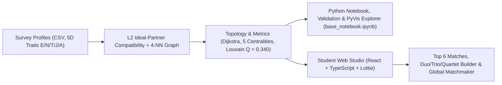

# MBTI Student Compatibility Network & Team Studio

This project models work-group compatibility among students as a weighted graph built on continuous 5D 16Personalities scores (`Energy E`, `Mind N`, `Nature T`, `Tactics J`, `Identity A`). It pairs a reproducible Python analytical notebook ($N = 25$ anonymized profiles in `mbti_profiles_anon.csv`) and statistical validation suite with **Synergy**, a student-facing interactive web application (`web/`) for exploring personal top matches, composing balanced **Duos, Trios, and Quartets**, and running cohort-wide team allocations.



---

## Quickstart & Deployment

### 1. Student Interactive Web App (`web/`)

```bash
cd web
npm install
npm run dev
```

Open `http://localhost:5173`. If a local `mbti_profiles.csv` is present at the repository root, Vite loads it automatically in memory (never tracked by Git); otherwise it falls back seamlessly to `mbti_profiles_anon.csv`.

### 2. Reproducible Analytical Notebook & Statistical Validation (`uv`)

```bash
uv sync
uv run python validation_checks.py
uv run jupyter lab base_notebook.ipynb
```

Running `validation_checks.py` verifies the Monte Carlo modularity null models, centroid Spearman correlations, categorical $\text{ARI}/\text{NMI}$, and $(k, \alpha)$ sensitivity grid. Running `base_notebook.ipynb` top-to-bottom reproduces every graph benchmark, Louvain robustness check, Edmonds maximum-weight matching proof, and regenerates standalone `graph.html`.

---

## Network Models Overview ($N = 25$ Public Cohort)

All three models are represented as simple, undirected, weighted graphs over completed student profiles:

| Model | Construction Rule | Nodes | Edges | Density | Components | Louvain Modularity $Q$ |
| :--- | :--- | :---: | :---: | :---: | :---: | :---: |
| **Baseline 1 — Trait Similarity (`G_sim`)** | Pairwise $L_1$ similarity $\ge 80\%$ across 5 traits | 25 | 174 | `0.580` | 1 | `0.126` |
| **Baseline 2 — Trait Contrast (`G_contrast`)** | Top-5 polar opposing profiles per student (union) | 25 | 97 | `0.323` | 1 | `0.117` |
| **Final Model — Compatibility (`G_compat`)** | Symmetric 5D target-partner fit + $k$-NN ($k = 4$) | **25** | **73** | **`0.243`** | **1** | **`0.340`** |

---

## Newcomer Map

| Path | Purpose |
| :--- | :--- |
| `web/src/App.tsx` | Main React workspace shell (*For You*, *Team Studio*, *Cohort Network*, `⌘K` switcher) |
| `web/src/engine/` | Client-side 5D compatibility, Dijkstra/Brandes metrics, Louvain, Duo/Trio/Quartet synergy & Edmonds Blossom matcher |
| `web/src/components/ForYouView.tsx` | Personal psychometric hero, 5D target spectrums, Top 6 matches & 1-on-1 radar deep-dive |
| `web/src/components/TeamStudioView.tsx` | Interactive Duo (2), Trio (3), and Quartet (4) builder, weakest-link monitor & next-member recommender |
| `web/src/components/CohortNetworkView.tsx` | Custom vector network stage with B-spline Louvain hulls & global cohort matchmaker |
| `assets/16personalities/` | 16Personalities Lottie character animations, vector avatars, scenes, and color palette |
| `base_notebook.ipynb` | End-to-end Python graph analytics, baseline sweeps, and matching proofs |
| `validation_checks.py` | Statistical validation script (Monte Carlo modularity, Spearman, $\text{ARI}/\text{NMI}$, $(k, \alpha)$ sensitivity) |
| `graph.html` | Standalone interactive network explorer (PyVis / `vis-network`) with Louvain filtering |
| `report/written-report.pdf` | Final written project report (PDF) on the anonymized $N = 25$ cohort |
| `mbti_profiles_anon.csv` | Anonymized class survey dataset (`S01`–`S33`) for out-of-the-box reproducibility |
| `pyproject.toml` | Reproducible `uv` project configuration (`mbti-graph-analytics`, locked in `uv.lock`) |

---

## Verification & Testing

```bash
# Run mathematical parity & team allocation unit tests (Vitest)
cd web && npm test

# Typecheck & build production bundle
cd web && npm run build
```

---

## Dataset & Privacy

To protect classmate privacy on public repositories, raw nominative CSV files (`mbti_profiles.csv`) are excluded from version control via `.gitignore` and resolved strictly in local memory when running the demo locally. Public artifacts use randomly permuted anonymous codes (`S01`–`S25`).
